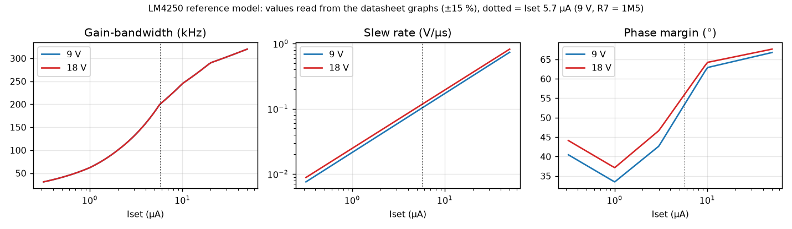
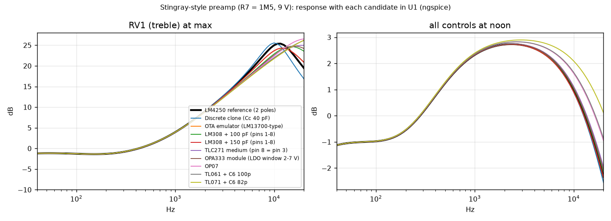
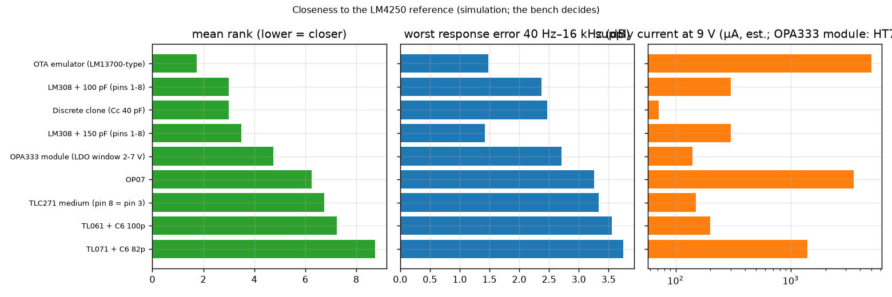
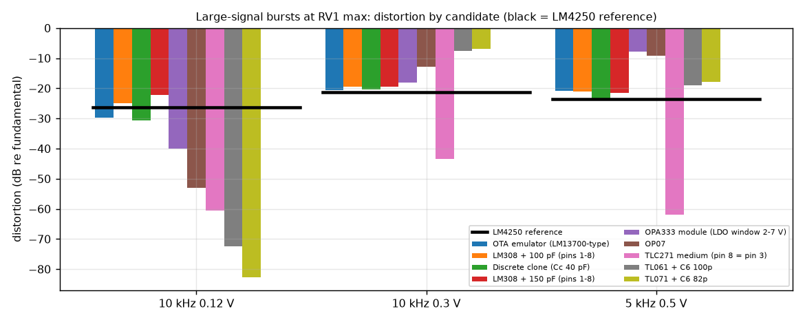
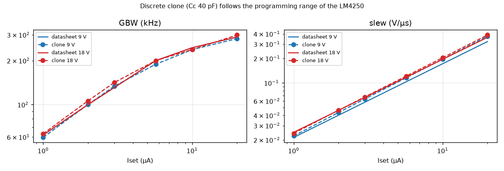
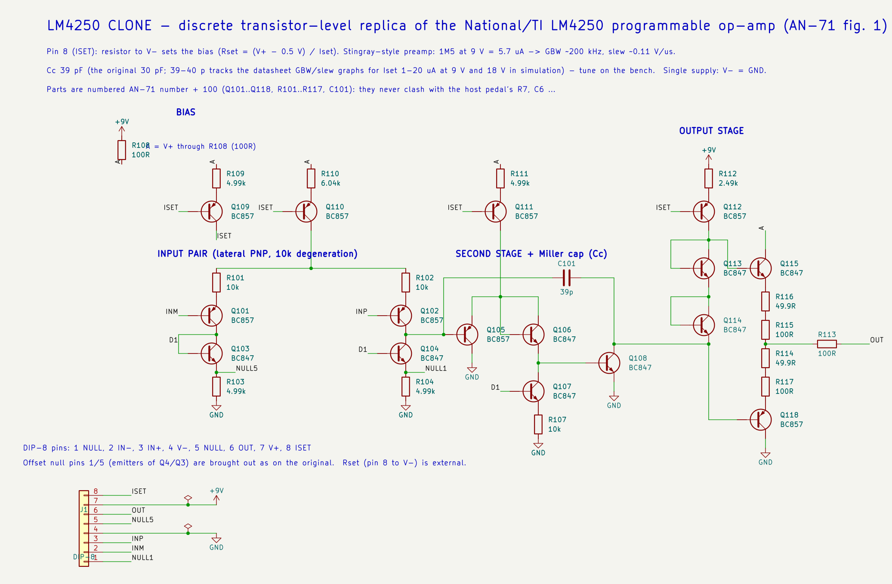
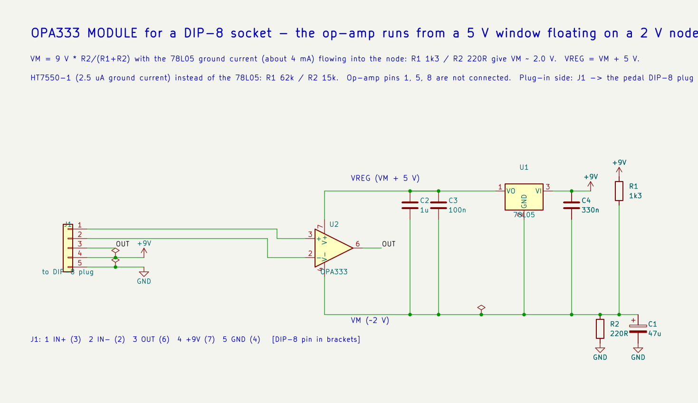
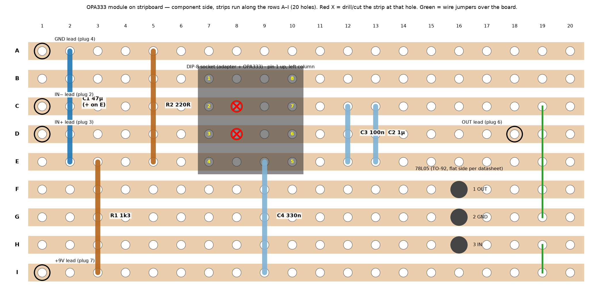

# Replacing the LM4250 — a programmable op-amp you can no longer buy

> **Status: work in progress.** The simulation phase is complete (ngspice + LTspice cross-checked); we are now moving to the **experimental phase** (breadboards, then captures of the real preamp with every variant). **Nothing here has been measured on real hardware yet.** All numbers are simulation results built on a reference model read from the datasheet graphs (±15 %). Expect corrections.

The National/TI **LM4250** is a single programmable op-amp (DIP-8, 741 pinout) that is long obsolete: what you find today is NOS stock and fakes.
It is used in the Music Man Stingray-style onboard bass preamp, biased at ~6 µA, where it behaves as a *slow* amplifier: gain-bandwidth ≈ 200 kHz and slew rate ≈ 0.11 V/µs.
A fast op-amp (TL071…) reproduces the frequency response almost everywhere but **not the treble peak and not the slew-limited distortion** at high treble boost.

This project collects, simulates and ranks **every practical way to get close to the original**, so builders have several options — and then compares data, simulations and real captures of the preamp, and finally audio clips on a bass track.

*Not affiliated with, or endorsed by, Music Man / Ernie Ball, Texas Instruments or any other trademark owner; names are used only to identify the circuit and the parts.*

## Contents
1. [The chip in one page](#1-the-chip-in-one-page)
2. [Why it matters in the Stingray-style preamp](#2-why-it-matters)
3. [Routes to a replacement](#3-routes)
4. [Results (9 V; 18 V as additional data)](#4-results)
5. [Where we are and what comes next](#5-status)
6. [Reproduce the simulations](#6-reproduce)
7. [Licences, sources, disclaimer](#7-licences)

## 1. The chip in one page
* One resistor on pin 8 sets the quiescent current **Iset**, and with it input bias current, slew rate, gain-bandwidth, noise and supply current: it is a different op-amp for every Rset.
* **Rset (to ground, single supply) = (V+ − 0.5 V) / Iset** (TI AN-71, eq. 3). The Stingray-style preamp uses 1M5 at 9 V → **Iset ≈ 5.7 µA** (11.7 µA at 18 V).
* Values read from the datasheet graphs at 5.7 µA, 9 V (±15 %): **GBW ≈ 200 kHz** (AN-71 quotes 200 kHz at 6 µA), **slew ≈ 0.11 V/µs**, **phase margin ≈ 50°**, input bias ≈ 10–15 nA, supply current ≈ 8 × Iset ≈ 46 µA, output swing to within a few hundred mV of the rails, class-B output.
* Input stage = lateral PNP pair with 10 kΩ degeneration → linear range ≈ 90 mV, hence a very low slew rate for its bandwidth (slew / 2π·GBW ≈ 88 mV).
* The full internal schematic is in TI AN-71, fig. 1; our drawn replica is in [`hardware/clone`](hardware/clone).



## 2. Why it matters
In the preamp the stage is ~0 dB at noon; the treble control adds up to **+24 dB around 10 kHz**. With 16× closed-loop gain and GBW 200 kHz the −3 dB point is ~12 kHz, and a 1–2 V peak at 10 kHz needs 0.06–0.13 V/µs: **the chip is bandwidth- and slew-limited exactly where the treble control works hardest.** The ~50° phase margin also gives a treble peak that fast op-amps do not reproduce.
Replacements must therefore reproduce **GBW, second pole and slew limiting** — not just the pin-out. A replacement right for one Rset is wrong for another, so we also characterise the parts independently of the circuit (section 4.2).

## 3. Routes
| # | Route | Sim: worst response error (RV1 max, 40 Hz–16 kHz) | Supply current (est., 9 V) | Notes |
|---|---|---|---|---|
| R1 | Real LM4250 (NOS) | – | ≈ 46 µA | scarce, counterfeits |
| R2 | **Discrete clone** of AN-71 fig. 1 on a DIP-8 module (SOT-23 or THT transistors, Cc ≈ 39–40 pF) | 2.5 dB | 71 µA | follows the programming range; schematic done |
| R3 | **OTA emulator**: LM13700 OTA (gm·tanh limit = slew) + inverting integrator | 1.5 dB | ≈ 5 mA | bench only; ≥ 9.5 V supply recommended by one datasheet |
| R4 | **Low-voltage op-amp module** (OPA333): 5 V regulator (78L05, or HT7550-1) with its GND pin on a ~2 V divider node → rails ~2–7 V centred on the 4.5 V bias; schematic + stripboard layout | 2.7 dB | ≈ 9 mA with a 78L05 (its 4 mA ground current must be absorbed by a low-value divider); ≈ 140 µA with an HT7550-1 | ±2.5 V headroom; supply ≥ 8.8 V (78L05 dropout); the op-amp alone cannot run from 9 V (max 5.5 V, abs. max 7 V) |
| R5 | LM308 + compensation capacitor between pins 1 and 8 (100–150 pF) | 2.4 / 1.4 dB | ≈ 300 µA | also obsolete |
| R6 | TLC271 (programmable CMOS; pin 8 to pin 3 = medium bias) | 3.3 dB | ≈ 150 µA | max 16 V |
| R7 | OP07, TL061, TL071 + C6 tweak (82–100 pF) | 3.3–3.7 dB | 0.2–3.5 mA | the drop-in fallbacks |
| – | Other programmable parts to check: µA776, LM346/LM146, ICL7611/7612 | ? | ? | availability to verify |

Not usable at 9 V as bare parts: OPA333, MCP6061, OPA391 (5.5–6 V maximum).

## 4. Results
### 4.1 One comparison for every candidate (Stingray-style preamp, R7 = 1M5, 9 V)
Same 15-point control grid, same large-signal bursts at RV1 max, metrics vs the LM4250 reference (`sim/compare_all.py`). Ranking = mean rank over worst-case level error, rms error, burst level and burst distortion; consumption listed, not ranked.

| # | Candidate | worst dB 40 Hz–16 kHz | rms dB | worst dB 16–20 kHz | burst level Δ dB | burst distortion Δ dB | mean rank | µA at 9 V |
|---|---|---|---|---|---|---|---|---|
| 1 | OTA emulator (LM13700-type) | 1.48 | 0.18 | 1.56 | 0.99 | 2.9 | 1.75 | 5000 |
| 2 | LM308 + 100 pF (pins 1-8) | 2.38 | 0.33 | 4.27 | 0.93 | 12.7 | 3.00 | 300 |
| 3 | Discrete clone (Cc 40 pF) | 2.47 | 0.24 | 2.69 | 1.19 | 4.3 | 3.00 | 71 |
| 4 | LM308 + 150 pF (pins 1-8) | 1.43 | 0.18 | 1.50 | 2.34 | 12.6 | 3.50 | 300 |
| 5 | OPA333 module (LDO window 2–7 V) | 2.71 | 0.37 | 4.95 | 1.22 | 18.8 | 4.75 | 140 (HT7550-1) / 9000 (78L05) |
| 6 | OP07 | 3.26 | 0.50 | 7.29 | 1.52 | 23.5 | 6.25 | 3500 |
| 7 | TLC271 medium (pin 8 = pin 3) | 3.34 | 0.45 | 5.71 | 1.88 | 28.7 | 6.75 | 150 |
| 8 | TL061 + C6 100p | 3.56 | 0.55 | 6.83 | 1.94 | 22.6 | 7.25 | 200 |
| 9 | TL071 + C6 82p | 3.74 | 0.66 | 6.85 | 1.96 | 31.4 | 8.75 | 1400 |





* The reference distorts at 10 kHz (−26 / −21 dB, slew limiting); fast parts (TL071, TL061, TLC271, OP07) stay clean (−60…−100 dB) → they sound different at high level whatever their frequency response. Part of the gap for those parts also comes from output clipping at 9 V (assumed rail headroom: 1.5 V TL07x, 2 V LM308, 0.5 V TLC271, 0.03 V OPA333 inside its 2–7 V window).
* The OTA emulator is "closest" partly *by construction* (same structure as the reference model); the discrete clone is an independent transistor-level model and is the physically more convincing result.
* Error figures are for 40 Hz–16 kHz; above ~16 kHz every replacement differs more (up to ~4–5 dB at 20 kHz) because of the ~50° phase-margin peak the fast parts do not reproduce; the clone reproduces it best.

### 4.2 Part-level bench, independent of R7 and of the circuit (9 V and 18 V)
`sim/bench2.py`: closed-loop ×10 bandwidth, follower step, supply current, Iset 1–20 µA. **Discrete clone with Cc = 40 pF vs the datasheet curves** (clone − reference):

| | Iset 1 µA | 2 | 3 | 5.7 | 10 | 20 |
|---|---|---|---|---|---|---|
| 9 V GBW | −4 % | 0 % | +2 % | −6 % | −3 % | −3 % |
| 9 V slew | +4 % | +8 % | +10 % | +12 % | +14 % | +16 % |
| 18 V GBW | +2 % | +6 % | +8 % | 0 % | −3 % | +3 % |
| 18 V slew | −3 % | 0 % | +2 % | +3 % | +5 % | +7 % |
| Iq (µA) 9 V / 18 V | 49 / 95 | 54 / 99 | 58 / 104 | 71 / 118 | 93 / 139 | 146 / 191 |



One clone, one Cc, follows the original over the whole programming range because it has the same pin-8 biasing structure. **Fixed-parameter op-amps never match**: the Iset range where GBW *and* slew are both within ±30 % of the LM4250 is empty for TL071, TL061, LF441, OP07, LM741, AD705, LT1006, OPA333 and TLC271 (medium), at 9 V and 18 V; LM308 + 150 pF only around 4 µA.
Supply limits: OPA333, MCP6061, OPA391 ≤ 5.5–6 V and TLC271 ≤ 16 V cannot run at 18 V.

### 4.3 18 V (additional data; the experiments are at 9 V)
With the same 1M5, Iset doubles (≈ 11.7 µA): worst-case level error in the preamp (RV1 max) — clone 0.9 dB, OTA emulator 1.2 dB, TL071 + C6 tweak 2.3 dB, OP07 1.4 dB, LM308 + 100 pF 0.5 dB, TL061 1.6 dB. The clone draws 118 µA.

### 4.4 Cross-check: ngspice vs LTspice
The same ten netlists run in LTspice (batch, `sim/lt_compare.py`): small signal ≤ 0.06 dB difference (10 frequencies × 15 settings); large-signal bursts within 0.1–0.3 dB in level and distortion (differences only on floors below −70 dB). The ranking is not a simulator artefact.

## 5. Status
* **Done (simulation):** reference model from the datasheet graphs, one-pole/two-pole macromodels, transistor-level clone from AN-71 fig. 1, OTA emulator, comparison of nine candidates, 9 V/18 V and Iset sweeps, ngspice/LTspice cross-check, KiCad schematic of the clone (ERC clean, connectivity checked against the simulated netlist).
* **Starting now (experimental):** breadboard builds of each variant on the preamp pedal at 9 V — see [`docs/BREADBOARD.md`](docs/BREADBOARD.md) and [`docs/MODS-STINGRAY-STYLE-9V.md`](docs/MODS-STINGRAY-STYLE-9V.md) — in the order TL071 → LM308 → TLC271 → LM13700 → OPA333 module → clone.
* **Then:** captures of the real preamp with every variant (same settings, same DI bass track; sweeps, 10 kHz burst at RV1 max), a real LM4250 if we can find a genuine one, comparison of data / simulations / captures, final ranking, and a video with audio clips on a bass track. 18 V experiments later.
* **Known limits:** LM308 and TLC271 parameters are datasheet typicals scaled or from memory; the reference comes from graph readings (±15 %); no noise, no thermal effects; the clone consumes ~25 µA more than the datasheet suggests; high-level waveform comparisons depend on the assumed rail headroom. **The bench measurements decide.**







## 6. Reproduce
Needs ngspice, Python 3 with numpy (matplotlib for plots); LTspice optional (see `sim/lt_compare.py` for the Mac batch setup).
```
cd sim
LM_VS=9 python3 mna.py                 # fast AC solver (validated against ngspice to 0.1 dB)
LM_VS=9 python3 compare_all.py         # the comparison of section 4.1 (writes ../data/compare_all.json)
python3 bench2.py                      # section 4.2
LM_VS=18 python3 emu.py CLONE          # 18 V runs (also opt.py / emu.py)
```
`data/` holds the result files used for the figures. `hardware/clone` holds the KiCad 10 schematic of the discrete clone (A3, drawn with real wires; labels only for the ISET / D1 / A rails and the DIP-8 pins; parts numbered +100) and its PDF; `hardware/opa333-module` the schematic of the OPA333 module and the stripboard layout script (check against the netlist). Stripboard guide: [`docs/VEROBOARD-OPA333-MODULE.md`](docs/VEROBOARD-OPA333-MODULE.md).

## 7. Licences
* Scripts: MIT ([LICENSE](LICENSE)). Text and figures: CC BY 4.0. Hardware files: CERN-OHL-S-2.0. See [LICENSING.md](LICENSING.md).
* Sources: Texas Instruments/National Semiconductor LM4250 datasheet and application note AN-71 (not redistributed; the circuit topology of fig. 1 is redrawn and re-simulated, the graph values are our own readings). HGSemi LM13700 datasheet for the OTA pin-out.
* **Disclaimer:** experimental, provided as is, without warranty. Simulations are not measurements. Check supply limits and pin-outs against the manufacturers' datasheets before wiring; do not connect the low-voltage op-amps (OPA333 etc.) to 9 V without the regulator module.
