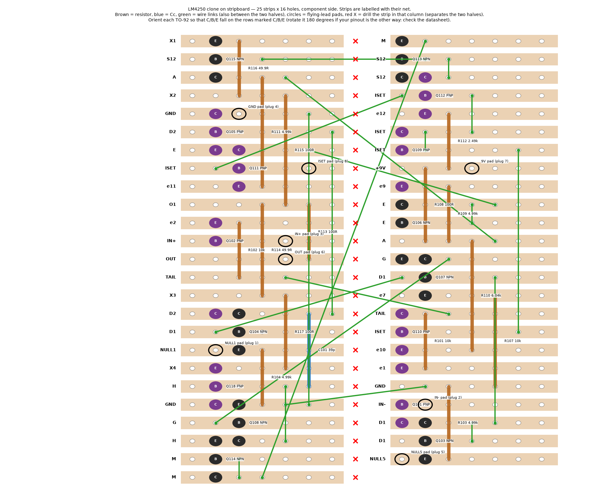

# LM4250 clone on stripboard (generated and verified)

**Board:** 25 strips × 16 holes (≈ 64 × 41 mm), strips along the rows, component side up. The design is **folded in two halves (L = left, R = right)** separated by a drilled column; each half is a block of 25 / 24 strips. Strips are numbered 1… from the top of the picture.
The layout was produced by `kicad/veroboard_clone.py` and **verified automatically** against the simulated netlist (every pin on its net, no shorts). Nets that need a second strip are joined by the wire links below (20 links); no track is cut except the fold column.

**Build order:** drill the fold column in all strips → resistors and Cc → transistors → wire links → pads/flying leads → check with a multimeter (continuity table at the end) → only then power up through the 5 flying leads to the DIP-8 plug (pins 1,2,3,4,5,6,7,8 as labelled; NULL1/NULL5 optional).

**Transistors:** TO-92 across three adjacent strips; the picture marks which strip is C, B, E. BC547/BC557 pin order is not the same for every maker (onsemi lists C-B-E, an older Philips datasheet E-B-C): check your datasheet, and rotate the part 180° if needed so that the legs fall on the strips marked C/B/E. Measure with a multimeter before soldering.

## Strip list (design row → half, strip number, net)

| Row | Half | Strip | Net |
|---|---|---|---|
| 1 | L | 1 | X1 |
| 2 | L | 2 | S12 |
| 3 | L | 3 | A |
| 4 | L | 4 | X2 |
| 5 | L | 5 | GND |
| 6 | L | 6 | D2 |
| 7 | L | 7 | E |
| 8 | L | 8 | ISET |
| 9 | L | 9 | e11 |
| 10 | L | 10 | O1 |
| 11 | L | 11 | e2 |
| 12 | L | 12 | IN+ |
| 13 | L | 13 | OUT |
| 14 | L | 14 | TAIL |
| 15 | L | 15 | X3 |
| 16 | L | 16 | D2 |
| 17 | L | 17 | D1 |
| 18 | L | 18 | NULL1 |
| 19 | L | 19 | X4 |
| 20 | L | 20 | H |
| 21 | L | 21 | GND |
| 22 | L | 22 | G |
| 23 | L | 23 | H |
| 24 | L | 24 | M |
| 25 | L | 25 | M |
| 26 | R | 1 | M |
| 27 | R | 2 | S12 |
| 28 | R | 3 | S12 |
| 29 | R | 4 | ISET |
| 30 | R | 5 | e12 |
| 31 | R | 6 | ISET |
| 32 | R | 7 | ISET |
| 33 | R | 8 | +9V |
| 34 | R | 9 | e9 |
| 35 | R | 10 | E |
| 36 | R | 11 | E |
| 37 | R | 12 | A |
| 38 | R | 13 | G |
| 39 | R | 14 | D1 |
| 40 | R | 15 | e7 |
| 41 | R | 16 | TAIL |
| 42 | R | 17 | ISET |
| 43 | R | 18 | e10 |
| 44 | R | 19 | e1 |
| 45 | R | 20 | GND |
| 46 | R | 21 | IN- |
| 47 | R | 22 | D1 |
| 48 | R | 23 | D1 |
| 49 | R | 24 | NULL5 |

## Components (half, strip, column)

| Part | Pins (half/strip/column) |
|---|---|
| Q101 | R19/c10 (e1), R21/c10 (IN-), R22/c10 (D1) |
| Q102 | L11/c2 (e2), L12/c2 (IN+), L16/c2 (D2) |
| Q103 | R22/c11 (D1), R23/c11 (D1), R24/c11 (NULL5) |
| Q104 | L16/c3 (D2), L17/c3 (D1), L18/c3 (NULL1) |
| Q105 | L5/c2 (GND), L6/c2 (D2), L7/c2 (E) |
| Q106 | R10/c10 (E), R11/c10 (E), R13/c10 (G) |
| Q107 | R13/c11 (G), R14/c11 (D1), R15/c11 (e7) |
| Q108 | L21/c3 (GND), L22/c3 (G), L23/c3 (H) |
| Q109 | R6/c10 (ISET), R7/c10 (ISET), R9/c10 (e9) |
| Q110 | R16/c10 (TAIL), R17/c10 (ISET), R18/c10 (e10) |
| Q111 | L7/c3 (E), L8/c3 (ISET), L9/c3 (e11) |
| Q112 | R3/c11 (S12), R4/c11 (ISET), R5/c11 (e12) |
| Q113 | R1/c10 (M), R2/c10 (S12), R3/c10 (S12) |
| Q114 | L23/c2 (H), L24/c2 (M), L25/c2 (M) |
| Q115 | L1/c2 (X1), L2/c2 (S12), L3/c2 (A) |
| Q118 | L19/c2 (X4), L20/c2 (H), L21/c2 (GND) |
| C101 | L16/c6 (D2) — L20/c6 (H) |
| R101 | R16/c11 (TAIL) — R19/c11 (e1) |
| R102 | L14/c3 (TAIL) — L11/c3 (e2) |
| R103 | R24/c12 (NULL5) — R20/c12 (GND) |
| R104 | L18/c4 (NULL1) — L21/c4 (GND) |
| R107 | R15/c14 (e7) — R20/c14 (GND) |
| R108 | R8/c11 (+9V) — R12/c11 (A) |
| R109 | R12/c12 (A) — R9/c12 (e9) |
| R110 | R12/c13 (A) — R18/c13 (e10) |
| R111 | L3/c4 (A) — L9/c4 (e11) |
| R112 | R8/c12 (+9V) — R5/c12 (e12) |
| R113 | L10/c6 (O1) — L13/c6 (OUT) |
| R114 | L15/c4 (X3) — L10/c4 (O1) |
| R115 | L4/c5 (X2) — L10/c5 (O1) |
| R116 | L1/c3 (X1) — L4/c3 (X2) |
| R117 | L19/c5 (X4) — L15/c5 (X3) |

## Wire links (jumpers)

| # | Net | From (half/strip/column) | To (half/strip/column) |
|---|---|---|---|
| 1 | GND | L5/c6 | L21/c6 |
| 2 | D2 | L6/c7 | L16/c7 |
| 3 | H | L20/c5 | L23/c5 |
| 4 | M | L24/c3 | L25/c3 |
| 5 | S12 | R2/c12 | R3/c12 |
| 6 | ISET | R4/c13 | R6/c13 |
| 7 | ISET | R6/c11 | R7/c11 |
| 8 | ISET | R7/c15 | R17/c15 |
| 9 | E | R10/c13 | R11/c13 |
| 10 | D1 | R14/c14 | R22/c14 |
| 11 | D1 | R22/c13 | R23/c13 |
| 12 | S12 | L2/c4 | R2/c11 |
| 13 | TAIL | L14/c5 | R16/c12 |
| 14 | D1 | L17/c2 | R14/c10 |
| 15 | GND | L21/c5 | R20/c11 |
| 16 | M | L25/c4 | R1/c11 |
| 17 | G | L22/c2 | R13/c12 |
| 18 | E | L7/c6 | R10/c14 |
| 19 | ISET | L8/c2 | R4/c10 |
| 20 | A | L3/c5 | R12/c14 |

## Pads for the flying leads (DIP-8 plug)

| Pad | Half/strip/column |
|---|---|
| 9V pad (plug 7) | R8/c13 (+9V) |
| GND pad (plug 4) | L5/c3 (GND) |
| IN- pad (plug 2) | R21/c11 (IN-) |
| IN+ pad (plug 3) | L12/c5 (IN+) |
| OUT pad (plug 6) | L13/c5 (OUT) |
| ISET pad (plug 8) | L8/c6 (ISET) |
| NULL1 pad (plug 1) | L18/c2 (NULL1) |
| NULL5 pad (plug 5) | R24/c10 (NULL5) |

## Notes
* The clone draws ≈ 70 µA (R7 1M5 on the pedal PCB sets ISET, like the real chip). Pin 8 (ISET) goes to the pedal's R7.
* Cc is C101 (39 pF C0G): tune 36–43 pF on the bench.
* 20 jumpers make this a fiddly build: for a clean result a small PCB (KiCad schematic included) is a better path.
* TO-92 BC547B/BC557B; choose matched pairs for Q101/Q102 and Q103/Q104.