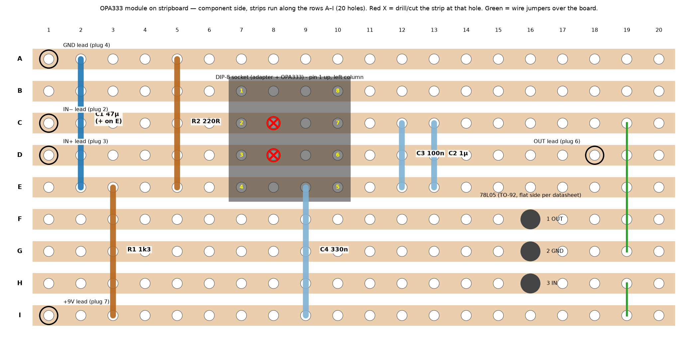

# OPA333 module on stripboard (9 V pedal)

Schematic: [`OPA333_MODULE-schematic.pdf`](../hardware/opa333-module/OPA333_MODULE-schematic.pdf) (KiCad source in `hardware/opa333-module/`). The layout was checked automatically against the schematic's nets (`hardware/opa333-module/veroboard.py`): no shorts, every pin on its net.

**What it does.** The OPA333 only tolerates 5.5 V (abs. max 7 V), so it never sees 9 V. A 78L05 whose *ground pin* sits on a ~2 V node (VM) makes a 5 V window VM … VREG ≈ 2 V … 7 V, centred on the pedal's 4.5 V bias. Op-amp V− = VM, V+ = VREG.

## Board
Stripboard 2.54 mm, **20 holes × 9 strips** (A–I), component side up, strips running along the rows (≈ 51 × 23 mm).
Drill/cut the strip at **hole C8 and hole D8** (under the socket). Nothing else is cut.

## Parts and holes (row letter, column)
| Part | Value | Holes |
|---|---|---|
| DIP-8 socket (for the SOIC-8→DIP-8 adapter with the OPA333) | | pins 1–4 in column 7 (B7, C7, D7, E7), pins 8–5 in column 10 (B10, C10, D10, E10); pin 1 up |
| R1 | 1k3 | E3 – I3 |
| R2 | 220 Ω | A5 – E5 |
| C1 | 47 µF 16 V electrolytic, **+ on E2**, − on A2 | A2 – E2 |
| C4 | 330 nF | E9 – I9 |
| C2 | 1 µF | C13 – E13 |
| C3 | 100 nF | C12 – E12 |
| U1 78L05 (TO-92) | | pins in column 16: **F16 = 1 (OUT), G16 = 2 (GND), H16 = 3 (IN)** |
| Jumper wires (over the board) | | F19 – C19, G19 – E19, H19 – I19 |
| Solder pads for the flying leads | | I1 = +9 V, A1 = GND, C1 = IN−, D1 = IN+, D18 = OUT |

Resistors R1 and R2 and the capacitors span several strips: that is intended (only their leads touch the strips A/E/I etc.). C1's 10 mm span: bend the leads.
Leave strip B unused: pins 1 and 8 of the op-amp are not connected.

## Flying leads to the DIP-8 plug that goes into the pedal's U1 socket
| Module pad | Plug pin |
|---|---|
| IN− (C1) | 2 |
| IN+ (D1) | 3 |
| GND (A1) | 4 |
| OUT (D18) | 6 |
| +9 V (I1) | 7 |

Pins 1, 5, 8 of the plug are not connected. Remove R7 from the pedal.

## Power-up test (do this with the OPA333 adapter NOT in the socket)
1. Supply the module through the plug (+9 V adapter; battery sag breaks the 78L05 dropout, see notes).
2. Measure VM (strip E) to GND: **≈ 2.0–2.1 V**.
3. Measure VREG (strip C, right part) minus VM: **5.0 V ± 0.25 V**. If it is wrong, stop: check the 78L05 orientation.
4. Only then insert the adapter with the OPA333 and check the pedal DC: output ≈ the input bias (≈ 4.5 V on the pedal's U1 output).

## Notes and corrections
* **78L05 ground current (≈ 4 mA, up to 5.5 mA)** flows into VM: that is why R1 1k3 / R2 220 Ω are so low (VM ≈ 2.07 V, ±0.3 V with part spread). Total draw ≈ 9 mA from the 9 V supply.
* **Dropout:** the regulator needs VI − VM ≥ ~6.7 V; with VM ≈ 2.07 V the supply must be ≥ **≈ 8.8 V**. Check VREG − VM; a battery below ~9 V will fail. Use the adapter.
* **TO-92 pin order of the 78L05 is not universal for other regulators.** The standard 78L05 is 1 OUT, 2 GND, 3 IN, but verify with your datasheet (flat side towards you, pins down).
* **HT7550-1 instead** (2.5 µA ground current, pin order varies by revision: GND-IN-OUT or OUT-IN-GND, input in the middle): use R1 62k and R2 15k (VM ≈ 2.0 V, ≈ 140 µA total) and rewire the three TO-92 strips with the jumpers: F, G, H are free strips, only the three jumpers (and the pin order) change — IN must go to 9 V, GND to VM, OUT to VREG.
* Headroom: output swing limited to ≈ ±2.5 V around 4.5 V (the real LM4250 swings ≈ ±4 V), so high input levels clip earlier.
* Simulation: the module behaves like the bare OPA333 model in the pedal (AC 1.6 dB over 40 Hz–16 kHz; fig. 2 in the main README). Real op-amp, regulator and stray capacitance will differ.
